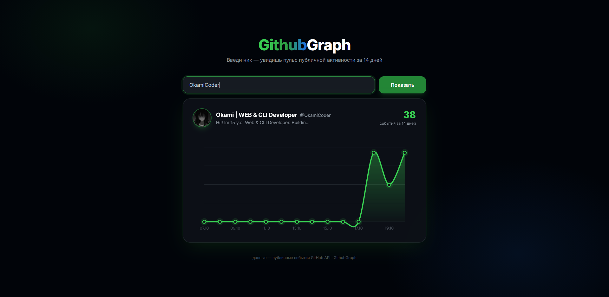

# GithubGraph 📊

<p>
  
</p>

A sleek, animated Vue.js web application that visualizes a user's GitHub contribution history over the last 14 days using the GitHub Public Events API. It features custom reactive SVG spline charts with smooth line-drawing effects.

## 🚀 Live Demo
See the app in action here: [Live Preview](https://github.io) *(Replace this link after enabling GitHub Pages)*

## ✨ Features
* **14-Day Activity Pulse:** Aggregates weighted GitHub public events (commits, PRs, issues, releases) into a daily timeline.
* **Reactive SVG Spline Chart:** Custom-built chart component featuring smooth cubic-bezier curve calculations, interactive hover states (`<title>`), and elegant CSS animations.
* **GitHub Theme Aesthetic:** Beautiful modern dark mode interface with radial gradients and neon glow inspired by native GitHub UI accents.
* **Vue.js Driven:** Clean reactive state management handling form validation, loading indicators, and asynchronous API calls.

## ⚠️ API Limitations & Edge Cases
* **1000 Event Bound:** The GitHub API restricts fetching public events to the most recent 300–1000 events depending on pagination. If a user exceeds this activity threshold within 14 days, the API returns an empty dataset or breaks limits, resulting in an empty chart rendering.
* **Rate Limits:** Standard unauthenticated browser requests are capped by GitHub API hourly limits. The app explicitly catches `403 Forbidden` statuses to inform users when limits are exhausted.

## 🛠️ Project Structure
```text
GithubGraph/
├── index.html          # Application entry point (Vue app mount)
├── css/
│   └── style.css       # Layout styles, gradients, and micro-interactions
└── js/
    ├── api.js          # Native Fetch API wrappers & event weight logic
    ├── chart.js        # Vue component for the animated SVG spline chart
    └── app.js          # Core Vue 3 composition app states
```

## ⚙️ Local Setup & Installation
Since the project relies entirely on vanilla modern JavaScript modules and CDN-hosted Vue.js, no bundlers or `npm install` steps are required.

1. **Clone the repository:**
   ```bash
   git clone https://github.com
   cd GithubGraph
   ```
2. **Run the project:**
   Simply open the `index.html` file directly in any modern web browser, or use a local static server (like VS Code Live Server).

## 📄 License
This project is open-source and available under the [MIT License](LICENSE).
